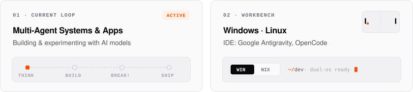

  <picture>
    <source media="(prefers-color-scheme: dark)" srcset="./assets/hero-dark.svg" />
    
  </picture>

  <picture>
    <source media="(prefers-color-scheme: dark)" srcset="./assets/bento-dark.svg" />
    
  </picture>

  <picture>
    <source media="(prefers-color-scheme: dark)" srcset="./assets/stack-dark.svg" />
    
  </picture>

  <a href="https://www.linkedin.com/in/jason-castillo-b63028330">
    <picture>
      <source media="(prefers-color-scheme: dark)" srcset="./assets/connect-dark.svg" />
      
    </picture>
  </a>

